<p align="center">
  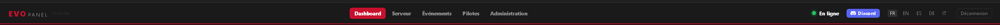
</p>

<h1 align="center">AC EVO Server Panel</h1>

<p align="center">
  <a href="LICENSE"></a>
  
  
  
  
</p>

<p align="center">
  Interface web pour gérer un ou plusieurs serveurs dédiés Assetto Corsa EVO.<br>
  <strong>Déploiement Docker (Linux) — panel et serveur dans des containers séparés.</strong>
</p>

<p align="center">
  <a href="#-installation-docker-linux">🐧 Installation</a> •
  <a href="#configuration">Configuration</a> •
  <a href="#mise-à-jour">Mise à jour</a> •
  <a href="#changelog">Changelog</a> •
  <a href="CONTRIBUTING.md">Contribuer</a> •
  <a href="https://ko-fi.com/zyphro3d">☕ Soutenir</a>
</p>

---

<p align="center">
  <strong>Ce projet est gratuit et open source.</strong><br>
  Si le panel tourne sur votre serveur et vous fait gagner du temps, un café est toujours apprécié ☕<br>
  Chaque soutien encourage le développement de nouvelles fonctionnalités.
</p>

<p align="center">
  <a href="https://ko-fi.com/zyphro3d"></a>
</p>

---

## Aperçu

<table>
  <tr>
    <td>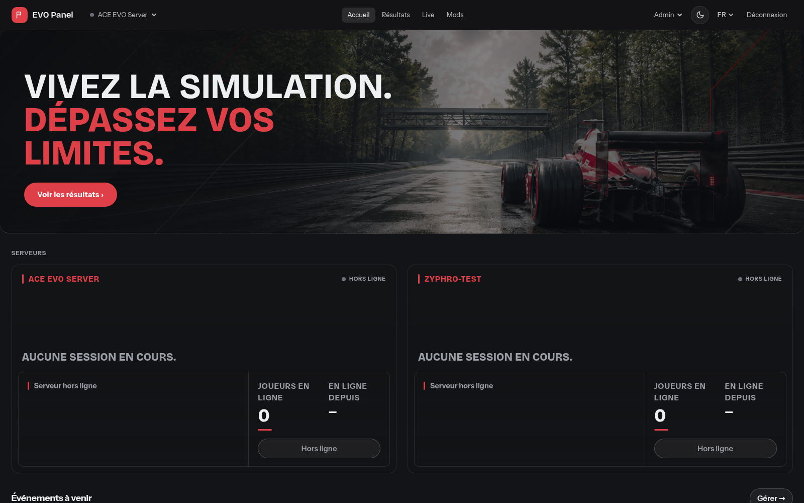</td>
    <td>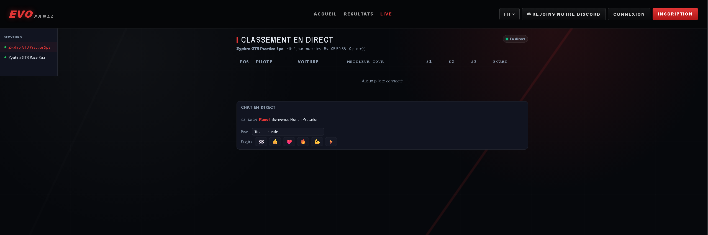</td>
  </tr>
  <tr>
    <td>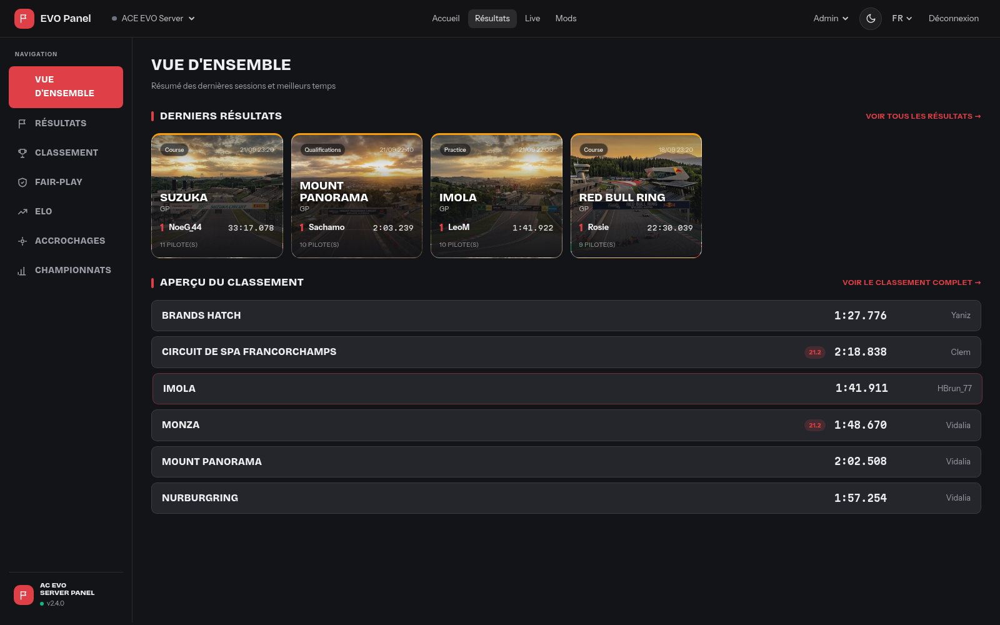</td>
    <td>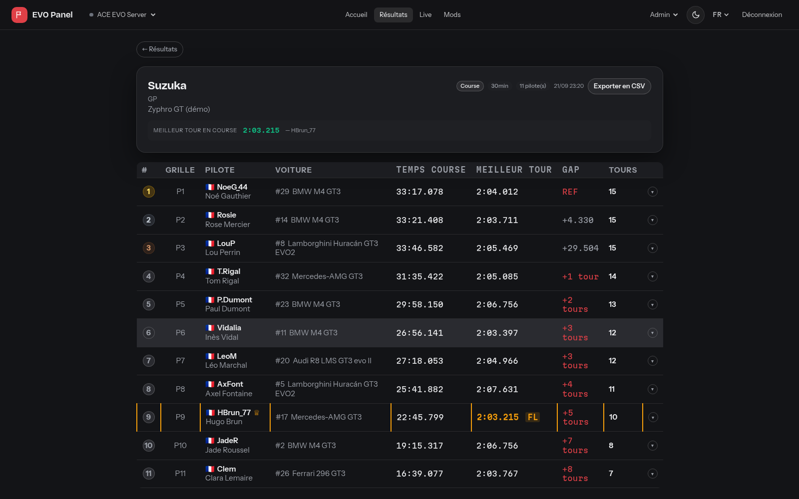</td>
  </tr>
  <tr>
    <td>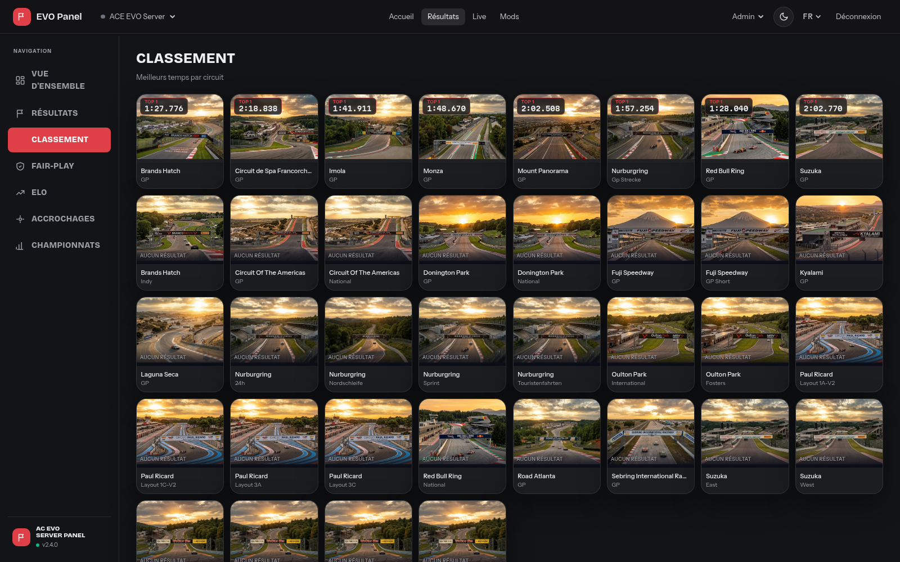</td>
    <td>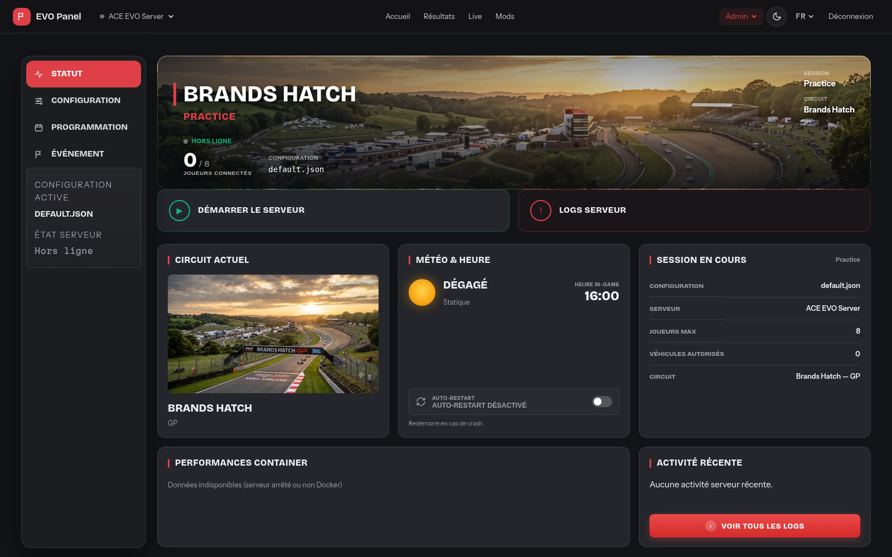</td>
  </tr>
  <tr>
    <td>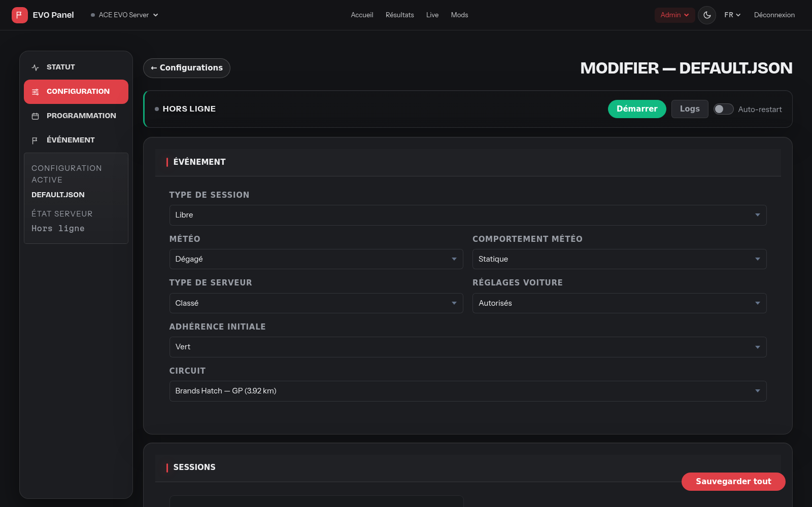</td>
    <td>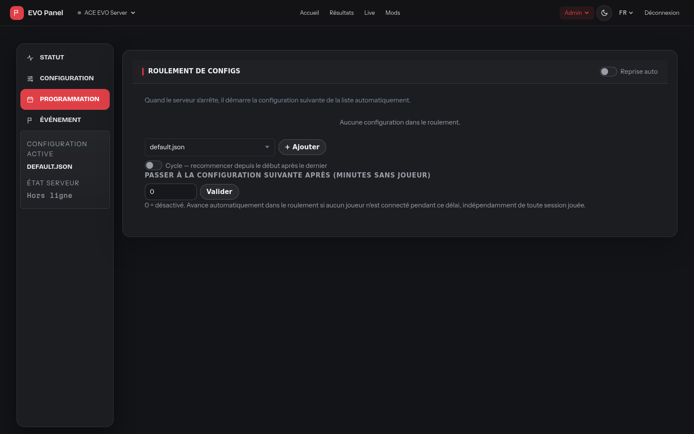</td>
  </tr>
  <tr>
    <td colspan="2">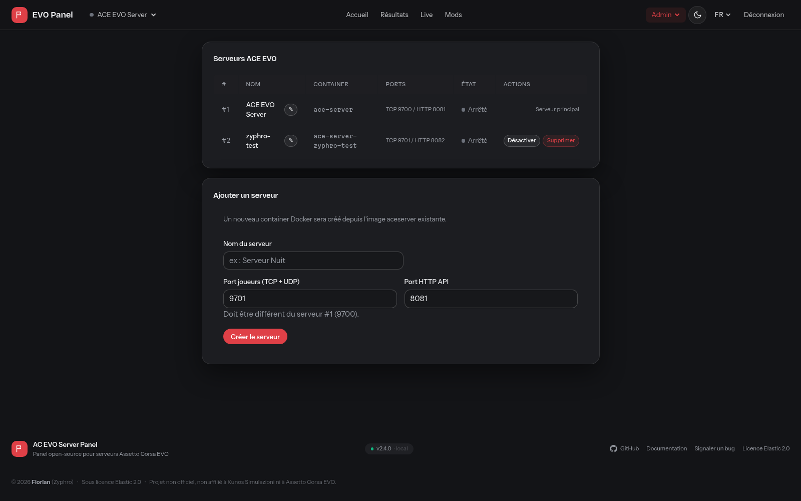</td>
  </tr>
  <tr>
    <td colspan="2">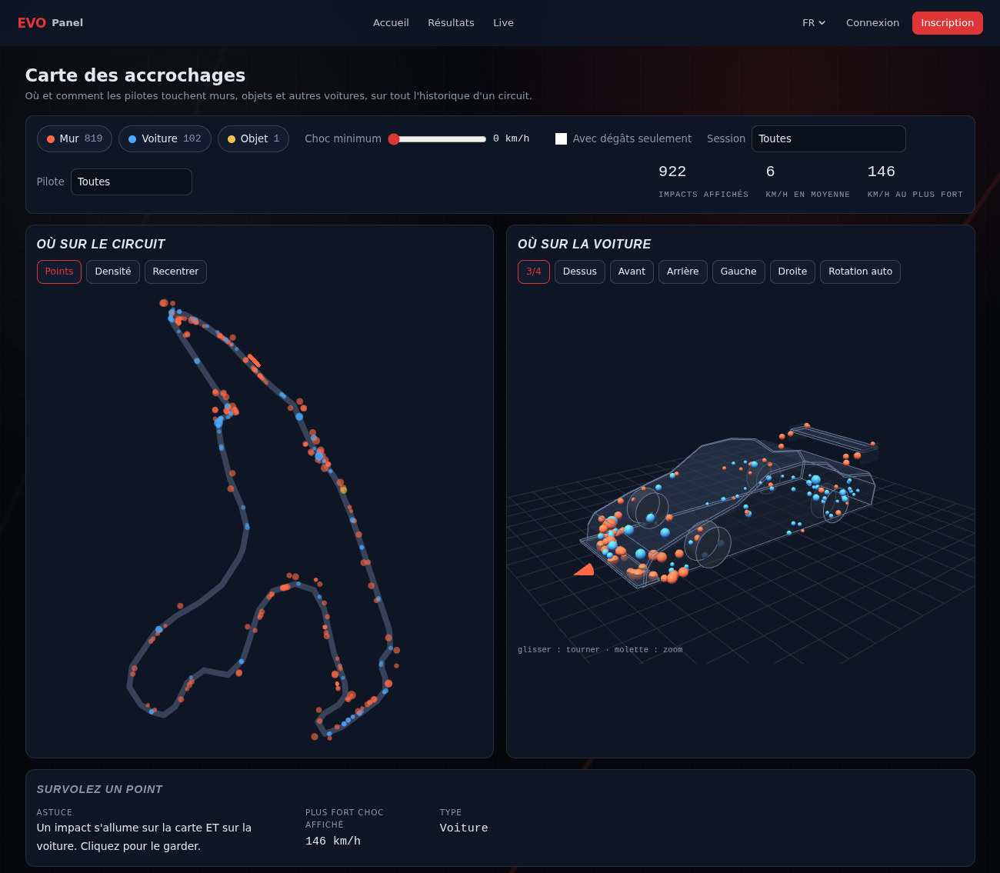</td>
  </tr>
</table>

---

## Fonctionnalités

Organisées par niveau d'accès — chaque rôle hérite des fonctionnalités des rôles en dessous :
Public ⊂ Pilote ⊂ Admin ⊂ Superadmin.

<details>
<summary><strong>Voir la matrice complète des droits</strong> (cliquer pour déplier)</summary>

| Fonctionnalité | Public | Pilote | Admin | Superadmin |
|---|:---:|:---:|:---:|:---:|
| Accueil, résultats, classements, timing en direct | ✓ | ✓ | ✓ | ✓ |
| Fair-play, ELO, championnats, carte des accrochages, exports CSV des classements | ✓ | ✓ | ✓ | ✓ |
| Inscription pilote, mot de passe oublié | ✓ | ✓ | ✓ | ✓ |
| Tableau de bord, inscription/désinscription aux événements | — | ✓ | ✓ | ✓ |
| Historique personnel des tours, liaison Steam | — | ✓ | ✓ | ✓ |
| Consulter / télécharger un mod véhicule | — | ✓ | ✓ | ✓ |
| Démarrer / arrêter / redémarrer le serveur, logs, métriques | — | — | ✓ | ✓ |
| Éditeur de config (circuit, météo, sessions, voitures), roulement | — | — | ✓ | ✓ |
| Créer / publier un événement, gérer les inscriptions | — | — | ✓ | ✓ |
| Approuver / rejeter un compte pilote | — | — | ✓ | ✓ |
| Uploader / supprimer un mod, poser ses tags (catégorie, PI) | — | — | ✓ | ✓ |
| Uploader une image véhicule / circuit | — | — | ✓ | ✓ |
| Modération in-game : chat, kick, mute, pénalités, lest | — | — | ✓ | ✓ |
| Gérer les championnats, l'accès au serveur (bannissements, lest), voir la santé du serveur | — | — | ✓ | ✓ |
| Journal d'audit, sauvegarde / restauration, réglages d'accès et de sécurité | — | — | — | ✓ |
| Variables `.env`, mise à jour SteamCMD du serveur de jeu | — | — | — | ✓ |
| Créer / supprimer un serveur additionnel (multi-serveurs) | — | — | — | ✓ |
| Créer / supprimer un compte admin, changer un rôle | — | — | — | ✓ |

</details>

**🌍 Public — aucun compte requis**
- Page d'accueil : serveurs en direct (joueurs connectés, circuit en cours), calendrier des prochains événements, derniers résultats
- Timing en direct par serveur, tours invalides signalés en temps réel (track limits, split manqué)
- Réactions emoji vers le chat in-game depuis la page timing
- Résultats de session détaillés : drapeaux, meilleurs tours, secteurs color-codés, gap au leader
- Classement par circuit avec filtres (véhicule, catégorie, plage de performance/PI) et meilleur temps mis en avant
- **Session en cours** sur le timing : nom de la session, phase (attente de départ, en cours, dernier tour, terminée) et temps restant estimé
- **Incidents et sanctions** dans chaque résultat : contacts, murs, objets, chocs avec dégâts, sanctions de course (avec leur cause, le tour et le moment)
- **Fair-play** : classement des pilotes à la conduite la plus propre (incidents par tour), avec un compteur que l'administrateur peut remettre à zéro
- **ELO** : niveau des pilotes d'après leurs courses, dans l'esprit de Low Fuel Motorsport (informatif ; refus de participation sous un seuil possible, désactivé par défaut)
- **Championnats** : points cumulés sur plusieurs courses (barème libre, bonus pole / meilleur tour, pires manches retirées, participation minimale), publics ou privés
- **Carte des accrochages** : le plan du circuit et une voiture en 3D, reliés — chaque impact (mur, voiture, objet) s'affiche à l'endroit de la piste et de la voiture où il a eu lieu, avec sa vitesse, ses dégâts et les pilotes concernés ; filtres, vue densité (37 circuits calés)
- **Contacts en direct** sur le timing (option) : qui vient de toucher qui, un mur ou un objet
- Exports CSV : classement d'une session, fair-play, championnats
- Inscription pilote (validation manuelle ensuite par un admin), confirmation d'email optionnelle
- Interface multilingue : FR / EN / ES / DE / IT

**🏎️ Pilote — compte connecté**
- Tableau de bord : inscriptions à venir/passées, événements privés disponibles, désinscription tant que l'inscription est en attente
- **Historique personnel des tours** : chaque tour roulé est enregistré en direct (temps, voiture, circuit), sans attendre la fin d'une session — au-delà d'une rétention configurable, l'historique est condensé en résumés mensuels plutôt que supprimé
- Liaison de compte Steam (identité vérifiée, requise pour l'historique des tours)
- Consultation de la bibliothèque de mods véhicules (upload réservé aux admins)

**🛠️ Admin**
- Démarrage / arrêt / restart du serveur, watchdog auto-restart, logs et métriques CPU/RAM en direct
- Éditeur de config JSON complet : circuit, météo, sessions (Practice / Qualifying / Warmup / Race), voitures
- Banque de véhicules (97 voitures, catégories Road/Race/Track, filtres, images) et banque de circuits (36 circuits, layout, longueur, images), upload des images véhicules/circuits
- **Gestion des mods véhicules** : upload multiple par glisser-déposer (`.kspkg`), tags manuels (catégorie, PI), image de couverture auto-détectée ou personnalisée, détection et signalement des conflits d'identifiant entre mods
- Roulement de configs avec file d'attente, glisser-déposer, option cycle
- Gestion complète des événements (création, publication, inscriptions, génération de l'`entry_list.json`) et des comptes pilotes (approbation/rejet)
- Emails transactionnels (approbation, rejet, rappel)
- Modération in-game depuis le panel : chat admin, kick, envoi aux stands, mute, pénalités, lest/restricteur, saut de session, **bannissement en direct** (`\ban`, enregistré dans la page Accès et signalé sur Discord)
- **Modes de jeu supplémentaires** : course instantanée, tour lancé, rallye, A vers B, test drive
- **Options de course** : course au nombre de tours, arrêt aux stands obligatoire (pneus / ravitaillement), sanctions personnalisées — toutes désactivées par défaut
- **Page Accès** : liste blanche des pilotes approuvés, bannissement par SteamID, lest et restricteur par joueur, refus selon le niveau ELO (option)
- **Avertissement de capacité** : si le nombre de joueurs dépasse celui des stands du circuit choisi
- **Santé du serveur** : en marche ou non, joueurs, CPU, mémoire, redémarrages, disponibilité sur 24 h et courbes, espace disque, dernière sauvegarde
- **Championnats** : création, choix des manches parmi les courses jouées, barème et bonus
- Exports CSV : tous les résultats, pilotes
- Élévation du bot du panel en admin in-game à la demande, redémarrage du container du serveur de jeu

**👑 Superadmin**
- Toutes les variables `.env` éditables depuis l'interface, sans accès SSH
- Gestion des comptes admin/superadmin (création, désactivation, suppression)
- Multi-serveurs : création, activation/désactivation, suppression de serveurs — chacun dans son propre container Docker, avec son propre bot et son propre watchdog
- **Mise à jour du serveur de jeu ACE EVO depuis l'interface** (SteamCMD, identifiants + code Steam Guard, suivi de progression en direct) — distincte de la mise à jour du panel lui-même
- **Journal d'audit** : qui a fait quoi, quand et depuis quelle adresse (connexions, serveur, réglages, comptes, sauvegardes) — jamais de secret ; filtres, export CSV, conservation configurable
- **Sauvegarde et restauration en un clic** : base, réglages, configurations, images ; sauvegarde automatique quotidienne ; restauration vérifiée (contenu, intégrité de la base, version) avec sauvegarde de sécurité préalable
- **Double authentification** : réinitialisation du 2FA d'un compte (appareil perdu)
- Upload des images véhicules/circuits

**🔒 Sécurité**
- CSRF, rate limiting, protection anti brute-force sur le login (blocage IP après 5 échecs), HSTS, CSP, X-Frame-Options
- **Double authentification (TOTP)** pour les comptes administrateurs : Google Authenticator, Aegis, 2FAS, Bitwarden… avec QR code, 10 codes de secours à usage unique, codes non rejouables
- **Journal d'audit** de toutes les actions d'administration
- **Ingestion des résultats authentifiée** : le serveur de jeu s'identifie par un jeton propre à l'installation, avec ou sans reverse proxy ; toute requête passée par un proxy sans jeton est refusée
- **IP réelle des visiteurs** derrière un reverse proxy (`TRUSTED_PROXIES`) : limite de débit et anti-brute-force par visiteur, pas par proxy
- Dépendances à jour (contrôle `pip-audit`), restauration de sauvegarde protégée contre les archives piégées

**🔔 Notifications Discord**
- Webhooks configurables par serveur : démarrage/arrêt/crash, connexions joueurs, meilleur tour, actions admin — avec fallback sur le webhook global
- **Récapitulatif de fin de session** (option) : podium, meilleur tour, incidents et sanctions regroupés par pilote ; notification des bannissements

**🎨 Interface**
- UI Tailwind CSS v3 + HTMX + Alpine.js — actions sans rechargement, toasts temps réel, transitions fluides
- Fuseau horaire configurable, statut rafraîchi toutes les 5 s
- Footer avec version, git hash et liens GitHub

---

## 🐧 Installation Docker (Linux)

**Prérequis** : Debian/Ubuntu (ou tout Linux), Docker + Docker Compose, compte Steam.

### 1. Télécharger le serveur ACE EVO via SteamCMD

```bash
# Installation SteamCMD sur Debian/Ubuntu
sudo dpkg --add-architecture i386
sudo apt update
sudo apt install -y lib32gcc-s1

mkdir -p /opt/steamcmd && cd /opt/steamcmd
curl -fsSL https://steamcdn-a.akamaihd.net/client/installer/steamcmd_linux.tar.gz | tar xz

/opt/steamcmd/steamcmd.sh \
  +@sSteamCmdForcePlatformType windows \
  +login TON_COMPTE_STEAM \
  +force_install_dir /opt/aceserver \
  +app_update 4564210 validate \
  +quit
```

### 2. Cloner le panel et copier les fichiers serveur

```bash
git clone https://github.com/Zyphro3D/pannel-ac-evo-server.git /opt/pannel-ac-evo-server

mkdir -p /opt/pannel-ac-evo-server/aceserver/configs
cp -r /opt/aceserver/* /opt/pannel-ac-evo-server/aceserver/
```

### 3. Configurer

```bash
cd /opt/pannel-ac-evo-server
cp .env.example .env
nano .env
```

Variables minimales à renseigner :

```env
SECRET_KEY=           # python3 -c "import secrets; print(secrets.token_hex(32))"
ADMIN_PASSWORD=
SUPERADMIN_PASSWORD=
PANEL_URL=            # https://votre-domaine.fr ou http://IP:4300
SESSION_COOKIE_SECURE=true   # false si HTTP sans reverse proxy
```

### 4. Builder et lancer

```bash
docker compose up -d --build
```

Deux containers sont construits puis démarrent :
- **`ace-panel`** — Flask (Python), port 4300 — le build compile aussi le CSS Tailwind (Node.js embarqué dans l'image, aucune dépendance locale)
- **`ace-server`** — Wine + AssettoCorsaEVOServer.exe, ports 9700 (TCP/UDP) + 8081 (HTTP)

Premier démarrage : ~5 min (build des images + initialisation Wine).

```bash
docker compose logs -f          # tous les logs
docker compose logs -f panel    # panel uniquement
docker compose logs -f aceserver # serveur de jeu uniquement
```

Le panel est accessible sur `http://IP:4300`.

### 5. Ouvrir les ports (accès depuis internet)

Configurez une redirection de ports sur votre box/routeur vers l'IP locale de votre serveur.

| Port | Protocole | Usage |
|---|---|---|
| `9700` | UDP + TCP | Connexions des joueurs (serveur de jeu ACE EVO) |
| `8081` | TCP | API HTTP ACE EVO — enregistrement Kunos (liste publique des serveurs) |
| `4300` | TCP | Interface web du panel — HTTP direct |
| `443` | TCP | Interface web du panel — HTTPS (Let's Encrypt ou reverse proxy) |

> **Multi-serveur** : chaque serveur supplémentaire utilise ses propres ports (ex. serveur 2 : 9701 TCP/UDP + 8082 HTTP). Ouvrez les ports correspondants.

### 6. Accès HTTPS (optionnel)

**Mode 1 — HTTP direct** (défaut, aucune config supplémentaire)
```
http://IP:4300
```

**Mode 2 — HTTPS intégré via Let's Encrypt**

```bash
sudo apt install certbot
sudo certbot certonly --standalone -d votre-domaine.fr
```

Dans `.env` :
```env
PANEL_PORT=443
SSL_CERTFILE=/etc/letsencrypt/live/votre-domaine.fr/fullchain.pem
SSL_KEYFILE=/etc/letsencrypt/live/votre-domaine.fr/privkey.pem
SESSION_COOKIE_SECURE=true
```

Dans `docker-compose.yml`, décommentez la ligne :
```yaml
- /etc/letsencrypt:/etc/letsencrypt:ro
```

Après chaque renouvellement du certificat :
```bash
docker compose up -d panel
```

**Mode 3 — Reverse proxy (Nginx, Caddy…)**

Laissez le panel sur HTTP port 4300 et gérez le SSL côté reverse proxy. Assurez-vous que `SESSION_COOKIE_SECURE=true` est défini dans `.env`.

### Architecture

```
docker compose
├── ace-panel       → Flask (port 4300) — rebuild rapide sans toucher au jeu
├── ace-server      → Wine + ACE EVO exe (ports 9700, 8081) — géré par le panel
├── ace-server-*    → Serveurs additionnels (multi-serveur, ports configurables)
└── dockerproxy     → Proxy Docker socket (isolation sécurité)

Volumes persistants :
  ./aceserver      → /aceserver   (configs, résultats, binaires)
  ./media          → /panel/media (images circuits, véhicules, bannières)
  panel_data                      (base de données SQLite)
  wine_prefix                     (prefix Wine du serveur principal)
```

**Structure du dossier `aceserver/` :**
```
aceserver/
├── AssettoCorsaEVOServer.exe   ← installé via SteamCMD (non versionné)
├── cars.json                   ← liste des voitures disponibles
├── events_practice.json        ← modèles de sessions practice
├── events_race_weekend.json    ← modèles de sessions race weekend
├── configs/                    ← fichiers de config JSON — créés par le panel, non versionnés
│   ├── default.json            ← créé automatiquement au premier démarrage
│   ├── *.json                  ← configs créées depuis l'interface
│   └── default.json.example   ← template fourni dans le repo
└── results/                    ← résultats de session — non versionnés
    └── result*.json
```

---

## Configuration

Référence complète des variables `.env` (voir aussi `.env.example`) :

### Général

| Variable | Description | Défaut |
|---|---|---|
| `SECRET_KEY` | Clé secrète Flask — **obligatoire en production** | — |
| `ADMIN_USERNAME` / `ADMIN_PASSWORD` | Compte admin | `admin` / — |
| `SUPERADMIN_USERNAME` / `SUPERADMIN_PASSWORD` | Compte superadmin | `superadmin` / — |
| `PANEL_URL` | URL publique (liens dans les emails) | `http://localhost:4300` |
| `PANEL_TIMEZONE` | Fuseau horaire | `Europe/Paris` |
| `DEFAULT_LOCALE` | Langue par défaut (`fr` / `en` / `es` / `de` / `it`) | `fr` |
| `SESSION_COOKIE_SECURE` | `true` derrière HTTPS, `false` en HTTP direct | `true` |
| `PANEL_PORT` | Port d'écoute du panel | `4300` |
| `PANEL_GITHUB_URL` | URL GitHub du projet (affichée dans le footer) | dépôt officiel |
| `RESULTS_INGEST_SECRET` | Secret HMAC du webhook résultats (`/api/results/ingest`). Facultatif : le serveur de jeu s'authentifie déjà par le jeton `sig` de l'URL que le panel lui donne, ou par le réseau interne (Docker / localhost) ; toute requête passée par un reverse proxy est refusée | — |
| `TRUSTED_PROXIES` | Reverse proxys autorisés à indiquer l'IP réelle du visiteur (adresses ou réseaux CIDR, séparés par des virgules). **Derrière Caddy/nginx/Cloudflare**, indiquer l'adresse du proxy vue par le panel : sans cela, limite de débit et anti-brute-force du login sont partagés par tous les visiteurs. Panel exposé directement : laisser vide | — |
| `BACKUP_AUTO` / `BACKUP_KEEP` | Sauvegarde automatique quotidienne du panel (base, réglages, configurations, images) et nombre de sauvegardes automatiques conservées | `true` / `7` |
| `AUDIT_RETENTION_DAYS` | Durée de conservation du journal d'audit, en jours | `365` |
| `RATING_ENFORCE` / `RATING_MIN_TO_JOIN` / `RATING_MIN_RACES` | Refus des pilotes définitifs dont l'ELO est sous le seuil (liste noire du serveur de jeu, nécessite le contrôle d'accès) ; réglé depuis la page Accès | `false` / `0` / `5` |
| `LIVE_COLLISIONS` | Affiche les derniers contacts sur le timing : lance le serveur de jeu avec `-log_debug gameplay` (une douzaine de lignes de log par session) ; pris en compte au prochain démarrage du serveur de jeu | `false` |
| `ACCESS_CONTROL_ENABLED` / `ACCESS_APPROVED_ONLY` | Contrôle d'accès au serveur de jeu (liste blanche des pilotes approuvés, bannissements, lest et restricteur) ; réglé depuis la page Accès | `false` / `false` |
| `SERVER_ENTRY_LIST_PATH` | Chemin d'un fichier d'engagés défini à la main : il reste prioritaire sur le contrôle d'accès | — |
| `LAP_HISTORY_RETENTION_MONTHS` | Nombre de mois de conservation détaillée de l'historique des tours pilote, au-delà archivé en résumé mensuel | `6` |

### Serveur de jeu

| Variable | Description | Défaut |
|---|---|---|
| `ACESERVER_HTTP_PORT` | Port HTTP de l'API ACE EVO (Kunos registration) | `8081` |
| `ACESERVER_TCP_HOST` | Hôte TCP ACE EVO | `127.0.0.1` |
| `ACESERVER_TCP_PORT` | Port TCP ACE EVO | `9700` |
| `SERVER_NAME` | Nom affiché dans la liste des serveurs ACE EVO | `ACE EVO Server` |
| `SERVER_MAX_PLAYERS` | Nombre maximum de joueurs | `8` |

### Bot TCP in-game *(optionnel)*

Le bot TCP se connecte au serveur ACE EVO pour envoyer des messages de bienvenue, détecter les meilleurs tours et alimenter le timing en direct.

| Variable | Description | Défaut |
|---|---|---|
| `ACE_BOT_STEAM_ID` | Steam ID du compte bot — **laisser vide pour désactiver** | — |
| `ACE_BOT_CAR_MODEL` | Modèle de voiture utilisé par le bot pour la connexion | `preset_190_evo_ii` |
| `ACE_BOT_IS_ADMIN` | `true` pour envoyer automatiquement `\admin <password>` à la connexion | `false` |
| `ACE_BOT_MSG_WELCOME` | Message de bienvenue (variables : `{name}`, `{discord_url}`, `{site_url}`) | — |
| `ACE_BOT_MSG_DISCORD` | Message Discord envoyé si `DISCORD_INVITE_URL` est défini | — |
| `ACE_BOT_MSG_SITE` | Message site envoyé si `PANEL_URL` est défini | — |

> **Multi-serveur** : un bot indépendant est démarré automatiquement pour chaque serveur activé. Chaque bot se connecte au container ACE EVO correspondant sur son port interne.

### HTTPS / SSL *(optionnel)*

| Variable | Description |
|---|---|
| `SSL_CERTFILE` | Chemin vers le certificat (ex: `/etc/letsencrypt/live/domain/fullchain.pem`) |
| `SSL_KEYFILE` | Chemin vers la clé privée (ex: `/etc/letsencrypt/live/domain/privkey.pem`) |

> Si les deux variables sont renseignées, le panel démarre en HTTPS via gunicorn. Sinon, il utilise waitress en HTTP.

### Discord *(optionnel)*

| Variable | Description |
|---|---|
| `DISCORD_WEBHOOK_URL` | Webhook principal (démarrage / arrêt / crash) |
| `DISCORD_PILOTS_WEBHOOK_URL` | Webhook pilotes — fallback sur le principal si vide |
| `DISCORD_RACE_WEBHOOK_URL` | Webhook course — fallback sur le principal si vide |
| `DISCORD_INVITE_URL` | Lien d'invitation affiché sur la page d'accueil |
| `DISCORD_NOTIFY_SESSION_SUMMARY` | Récapitulatif de fin de session sur le webhook course (podium, meilleur tour, incidents, sanctions) | `false` |

### Emails *(optionnel)*

| Variable | Description | Défaut |
|---|---|---|
| `MAIL_SERVER` | Serveur SMTP — vide pour désactiver | — |
| `MAIL_PORT` | Port SMTP | `587` |
| `MAIL_USE_TLS` | STARTTLS | `true` |
| `MAIL_USERNAME` / `MAIL_PASSWORD` | Identifiants SMTP | — |
| `MAIL_FROM` | Adresse expéditeur | — |
| `MAIL_ADMIN` | Adresse(s) admin pour les notifications (virgule) | — |

---

## Mise à jour

```bash
cd /opt/pannel-ac-evo-server
git pull

# Rebuild uniquement le panel (sans toucher au serveur de jeu)
docker compose up -d --build panel

# Rebuild complet (panel + serveur de jeu + tous les serveurs additionnels)
docker compose up -d --build
```

Le `.env` et la base de données ne sont jamais modifiés par une mise à jour. Les migrations de schéma s'appliquent automatiquement au démarrage.

> **Rebuild complet et multi-serveur** : `docker-compose.override.yml` est auto-généré par le panel et référence tous vos serveurs additionnels. Un `docker compose up -d --build` reconstruit **tous** les containers (principal + additionnels) sans intervention manuelle.

> **Personnalisations Docker locales** : ne modifiez pas `docker-compose.yml` directement — vos changements créeraient des conflits à chaque `git pull`. Utilisez `docker-compose.override.yml` à la place (Docker Compose le fusionne automatiquement). Notez que le panel régénère ce fichier pour la section `services` des serveurs additionnels ; ajoutez vos surcharges dans une section séparée.

> **Configs serveur** : les fichiers `aceserver/configs/*.json` sont créés et gérés par le panel, ils ne sont pas versionnés dans git. Un `git pull` ne les modifiera jamais.

> **Ceci met à jour le panel, pas le serveur de jeu.** Pour mettre à jour ACE EVO Server lui-même (nouveau build Steam), utilisez le bouton de mise à jour dans l'interface (superadmin) — il lance SteamCMD avec suivi de progression, sans passer par la ligne de commande.

---

## Changelog

Voir [CHANGELOG.md](CHANGELOG.md) pour l'historique complet des versions.

---

## Soutenir le projet

Le panel est développé sur le temps libre, distribué gratuitement, et maintenu activement.
Si vous l'utilisez pour vos courses ou votre club, un café aide à garder la motivation et à financer les prochaines fonctionnalités.

<a href="https://ko-fi.com/zyphro3d"></a>

---

## Licence

[CC BY-NC 4.0](LICENSE) — Usage personnel et communautaire libre, usage commercial interdit.

> **Crédits Wine** : approche Docker inspirée de [VandaLpr/acevo-docker-server](https://github.com/VandaLpr/acevo-docker-server).
