🇫🇷 [Version française](README.fr.md)

<p align="center">
  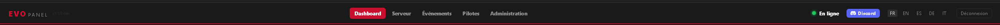
</p>

<h1 align="center">AC EVO Server Panel</h1>

<p align="center">
  <a href="LICENSE"></a>
  
  
  
  
</p>

<p align="center">
  Web interface to manage one or more Assetto Corsa EVO dedicated servers.<br>
  <strong>Docker deployment (Linux) — panel and server in separate containers.</strong>
</p>

<p align="center">
  <a href="https://evopanel.zyphro.fr">🌐 evopanel.zyphro.fr website</a> •
  <a href="https://github.com/Zyphro3D/pannel-ac-evo-server/wiki/Getting-Started">📖 Getting started (EN)</a> •
  <a href="https://youtu.be/8FkRYu5EXPA">🎬 Video tutorial (EN)</a> •
  <a href="https://youtu.be/gVG6A2pLf04">🎬 Video tutorial (FR)</a> •
  <a href="#-installation">🚀 Installation</a> •
  <a href="#configuration">Configuration</a> •
  <a href="#update">Update</a> •
  <a href="#changelog">Changelog</a> •
  <a href="CONTRIBUTING.md">Contributing</a> •
  <a href="https://patreon.com/Zyphro">Support on Patreon</a>
</p>

---

<p align="center">
  <strong>The source code is public: use it and modify it as you wish.</strong><br>
  If the panel runs on your server and saves you time, you can support Zyphro on Patreon<br>
  (early access to versions, and a say in upcoming features).
</p>

<p align="center">
  <a href="https://patreon.com/Zyphro"><strong>Support Zyphro on Patreon</strong></a>
</p>

---

## Overview

<table>
  <tr>
    <td>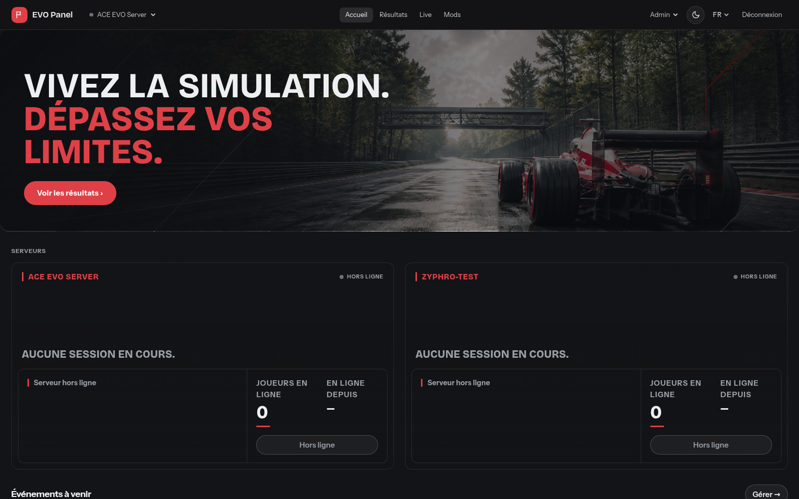</td>
    <td>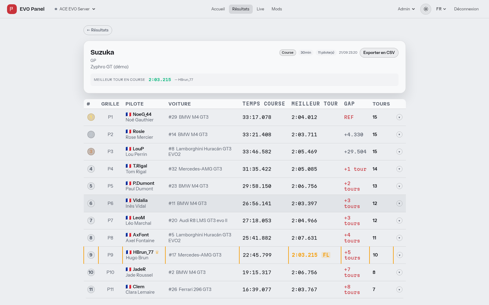</td>
  </tr>
  <tr>
    <td>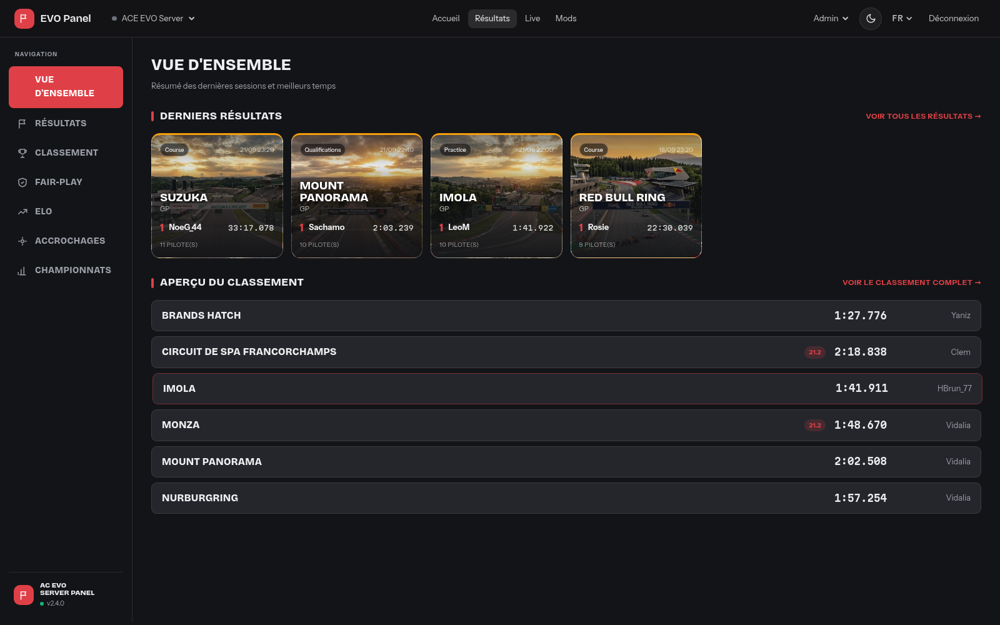</td>
    <td>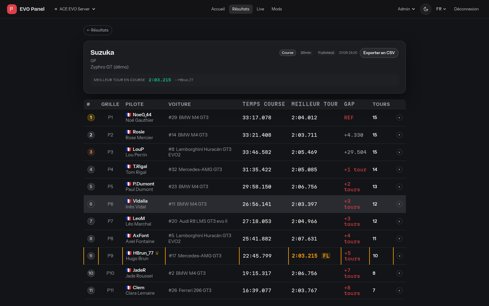</td>
  </tr>
  <tr>
    <td>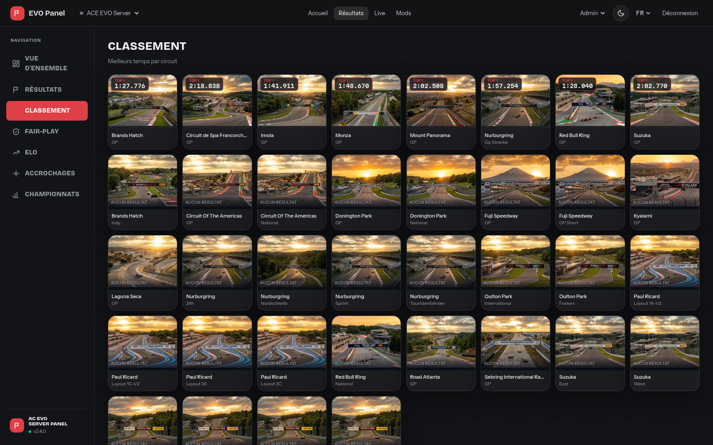</td>
    <td>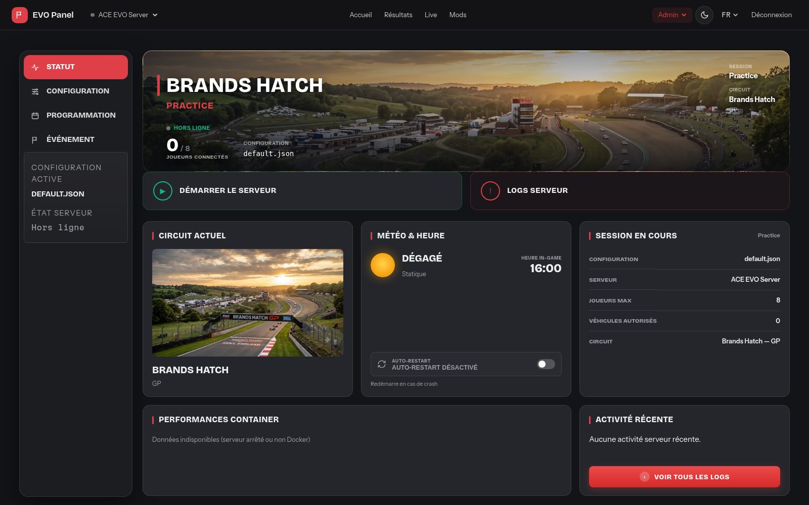</td>
  </tr>
  <tr>
    <td>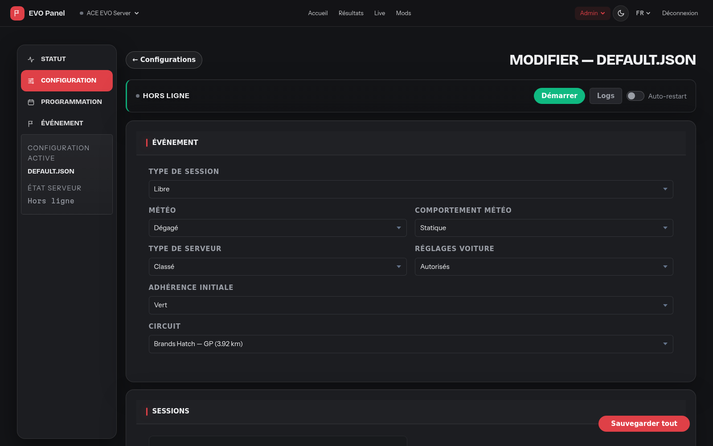</td>
    <td>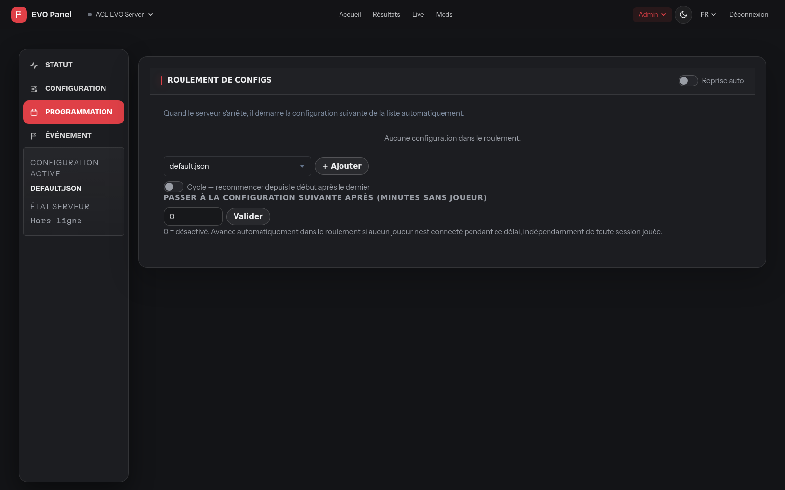</td>
  </tr>
  <tr>
    <td colspan="2">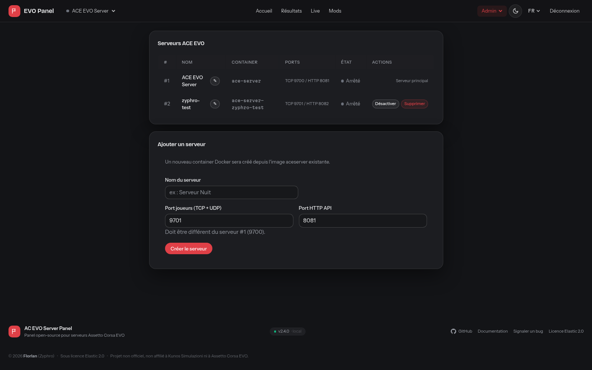</td>
  </tr>
  <tr>
    <td colspan="2">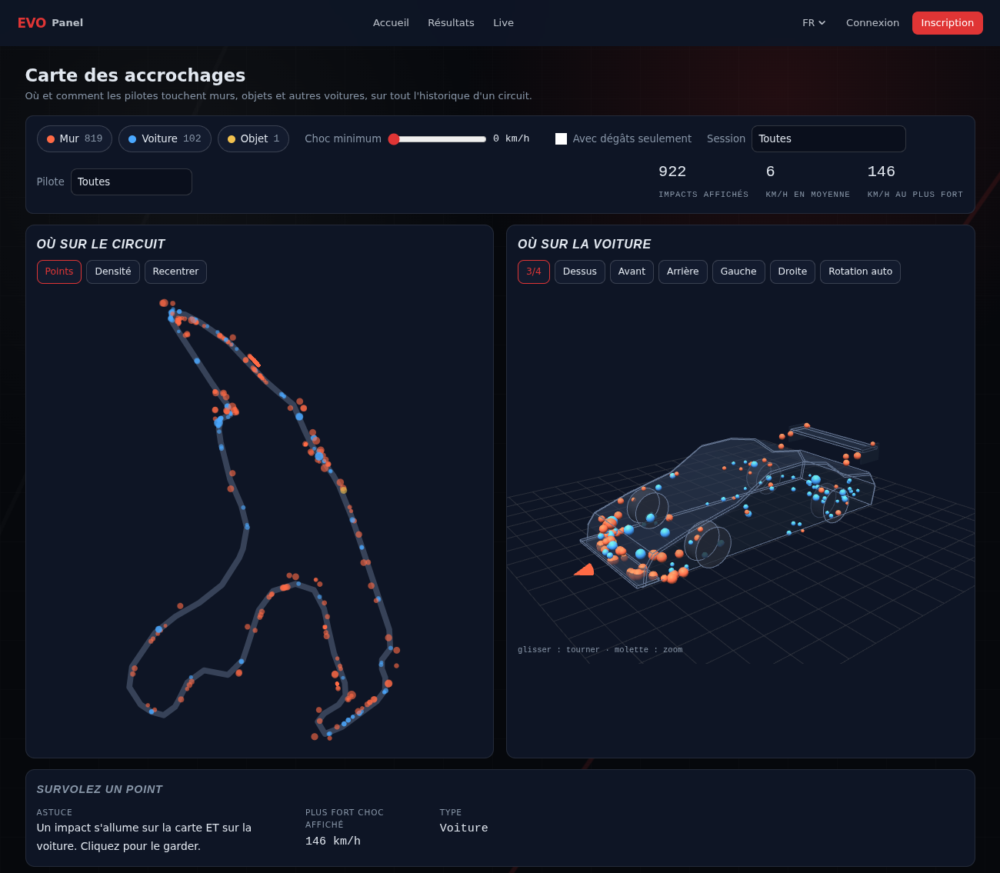</td>
  </tr>
</table>

---

## Features

Organized by access level — each role inherits the features of the roles below it:
Public ⊂ Driver ⊂ Admin ⊂ Superadmin.

<details>
<summary><strong>See the full permissions matrix</strong> (click to expand)</summary>

| Feature | Public | Driver | Admin | Superadmin |
|---|:---:|:---:|:---:|:---:|
| Home, results, leaderboards, live timing | ✓ | ✓ | ✓ | ✓ |
| Fair play, ELO, championships, collision map, CSV exports of leaderboards | ✓ | ✓ | ✓ | ✓ |
| Driver sign-up, forgotten password | ✓ | ✓ | ✓ | ✓ |
| Dashboard, event registration/unregistration | — | ✓ | ✓ | ✓ |
| Personal lap history, Steam linking | — | ✓ | ✓ | ✓ |
| View / download a vehicle mod | — | ✓ | ✓ | ✓ |
| Start / stop / restart the server, logs, metrics | — | — | ✓ | ✓ |
| Config editor (track, weather, sessions, cars), rotation | — | — | ✓ | ✓ |
| Create / publish an event, manage registrations | — | — | ✓ | ✓ |
| Approve / reject a driver account | — | — | ✓ | ✓ |
| Upload / delete a mod, set its tags (category, PI) | — | — | ✓ | ✓ |
| Upload a vehicle / track image | — | — | ✓ | ✓ |
| In-game moderation: chat, kick, mute, penalties, ballast | — | — | ✓ | ✓ |
| Manage championships, server access (bans, ballast), view server health | — | — | ✓ | ✓ |
| Audit log, backup / restore, access and security settings | — | — | — | ✓ |
| `.env` variables, SteamCMD update of the game server | — | — | — | ✓ |
| Create / delete an additional server (multi-server) | — | — | — | ✓ |
| Create / delete an admin account, change a role | — | — | — | ✓ |

</details>

**🌍 Public — no account required**
- Home page: live servers (connected players, current track), calendar of upcoming events, latest results
- Live timing per server, invalid laps flagged in real time (track limits, missed split)
- Live in-game chat on the timing page (player messages, history kept for 30 days, server replies to admin commands visible to admins)
- Emoji reactions sent to the in-game chat from the timing page (sent as a symbol the game can display)
- Detailed session results: flags, best laps, color-coded sectors, gap to the leader
- Leaderboard per track with filters (vehicle, category, performance/PI range) and best time highlighted
- **Current session** on the timing page: session name, phase (waiting for start, in progress, last lap, finished) and estimated time remaining
- **Incidents and penalties** in each result: contacts, walls, objects, impacts with damage, race penalties (with their cause, the lap and the moment)
- **Fair play**: ranking of the drivers with the cleanest driving (incidents per lap), with a counter the administrator can reset to zero
- **ELO**: driver level based on their races, in the spirit of Low Fuel Motorsport (informational; refusing entry below a threshold is possible, disabled by default)
- **Championships**: points accumulated over several races (custom scoring, pole / best lap bonuses, worst rounds dropped, minimum participation), public or private
- **Collision map**: the track layout and a 3D car, linked — each impact (wall, car, object) is shown at the place on the track and on the car where it happened, with its speed, its damage and the drivers involved; filters, density view (37 tracks calibrated)
- **Live contacts** on the timing page (option): who just touched whom, a wall or an object
- **Race control** (admins, with "Live contacts"): all contacts of the session with the time and lap, summary per driver, "to watch" drivers from 3 contacts; optional summary on Discord, one message per minute
- CSV exports: session leaderboard, fair play, championships
- Driver sign-up (then manual validation by an admin), optional email confirmation
- Multilingual interface: FR / EN / ES / DE / IT

**🏎️ Driver — signed-in account**
- Dashboard: upcoming/past registrations, available private events, unregistration while the registration is pending
- **Personal lap history**: every lap driven is recorded live (time, car, track), without waiting for the end of a session — beyond a configurable retention period, the history is condensed into monthly summaries rather than deleted
- Steam account linking (verified identity, required for the lap history)
- Browsing the vehicle mod library (upload reserved for admins)
- **Public "Mods" page**: for each server with mods, the pack and the files to install (or the link to the author's page), without an account
- **Join a championship in one minute**: Steam sign-in, nickname, email and car, registration confirmed for the server's upcoming rounds

**🛠️ Admin**
- Server start / stop / restart, auto-restart watchdog, live logs and CPU/RAM metrics
- Full JSON config editor: track, weather, sessions (Practice / Qualifying / Warmup / Race), cars
- Vehicle bank (97 cars, Road/Race/Track categories, filters, images) and track bank (36 tracks, layout, length, images), upload of vehicle/track images
- **Vehicle mod management**: multiple upload by drag and drop (`.kspkg`), manual tags (category, PI), auto-detected or custom cover image, detection and reporting of identifier conflicts between mods
- **Mods per server**: each mod is loaded (and therefore required from players) only by the servers that are checked; client pack or link to the author per server
- **Registered-only server**: the bot warns an unregistered driver in English then kicks them after a delay, welcomes a registered one and sends back to the pits anyone who does not have the car of their registration; a panel admin is never kicked
- Config rotation with a queue specific to each server, drag and drop, cycle option
- Admin menu in 4 explained groups, "Where do I set…?" search (`Ctrl+K`) that leads straight to the right setting
- Complete management of events (creation, publication, registrations, generation of `entry_list.json`) and driver accounts (approval/rejection)
- Transactional emails (approval, rejection, reminder)
- In-game moderation from the panel: admin chat, kick, send to the pits, mute, penalties, ballast/restrictor, session skip, **live ban** (`\ban`, recorded in the Access page and reported on Discord)
- **Additional game modes**: quick race, hotlap, rally, A to B, test drive
- **Race options**: race by number of laps, mandatory pit stop (tires / refueling), custom penalties — all disabled by default
- **Access page**: whitelist of approved drivers, ban by SteamID, ballast and restrictor per player, refusal based on ELO level (option)
- **Capacity warning**: if the number of players exceeds the number of pit boxes of the chosen track
- **Server health**: running or not, players, CPU, memory, restarts, 24 h availability and charts, disk space, last backup
- **Championships**: creation, choice of rounds among the races played, scoring and bonuses
- CSV exports: all results, drivers
- Elevation of the panel bot to in-game admin on demand, restart of the game server container

**👑 Superadmin**
- All `.env` variables editable from the interface, without SSH access
- Management of admin/superadmin accounts (creation, deactivation, deletion)
- Multi-server: creation, activation/deactivation, deletion of servers — each in its own Docker container, with its own bot and its own watchdog
- **Update of the ACE EVO game server from the interface** (SteamCMD, credentials + Steam Guard code, live progress tracking) — separate from the update of the panel itself
- **Audit log**: who did what, when and from which address (logins, server, settings, accounts, backups) — never any secret; filters, CSV export, configurable retention
- **One-click backup and restore**: database, settings, configurations, images; automatic daily backup; verified restore (content, database integrity, version) with a prior safety backup
- **Two-factor authentication**: reset of an account's 2FA (lost device)
- Upload of vehicle/track images

**🔒 Security**
- **Rootless panel**: inside its container, the panel runs under an unprivileged account (uid 1000); existing installations are converted at first startup
- CSRF, rate limiting, brute-force protection on the login (IP block after 5 failures), HSTS, CSP, X-Frame-Options
- **Two-factor authentication (TOTP)** for administrator accounts: Google Authenticator, Aegis, 2FAS, Bitwarden… with QR code, 10 single-use backup codes, non-replayable codes
- **Audit log** of all administration actions
- **Authenticated results ingestion**: the game server identifies itself with a token specific to the installation, with or without a reverse proxy; any request that went through a proxy without a token is refused
- **Real visitor IP** behind a reverse proxy (`TRUSTED_PROXIES`): rate limiting and brute-force protection per visitor, not per proxy
- Up-to-date dependencies (`pip-audit` check), backup restore protected against booby-trapped archives

**🔔 Discord notifications**
- Webhooks configurable per server: start/stop/crash, player connections, best lap, admin actions — with fallback to the global webhook
- Readable messages: server in the header, time shown in each reader's time zone, car and track names in plain language, clickable nickname linking to Steam, server record recalled with the best lap, crash message that turns green when the server comes back up
- **End-of-session summary** (option): podium, best lap, incidents and penalties grouped by driver; ban notifications

**🎨 Interface**
- **Light and dark theme** (sun/moon button; follows the device setting by default), readable on a phone
- Tailwind CSS v3 + HTMX + Alpine.js UI — actions without page reload, real-time toasts, smooth transitions
- Configurable time zone, status refreshed every 5 s
- Footer with version, git hash and GitHub links

---

## 🚀 Installation

> 📖 **Pas à pas avec captures / step-by-step guide with screenshots (English):** [Getting started](https://github.com/Zyphro3D/pannel-ac-evo-server/wiki/Getting-Started)
>
> 🎬 **Video tutorial (8 min):** [in English](https://youtu.be/8FkRYu5EXPA) · [en français](https://youtu.be/gVG6A2pLf04): installation, first steps, server, mods, drivers, events, live and results.

A single command installs the panel and its game server (Docker, Wine included); **the same command updates it**. Nothing to clone, nothing to configure by hand: keys and passwords are generated, and the panel installs SteamCMD itself and then offers to download the ACE EVO server at first login — you just enter your Steam account.

**Requirements**: a Steam account that owns Assetto Corsa EVO (Steam's anonymous account cannot access the server).

### 🐧 Linux (Debian, Ubuntu…)

```bash
curl -fsSL https://raw.githubusercontent.com/Zyphro3D/pannel-ac-evo-server/master/install.sh | sudo bash
```

Docker is offered during installation if it is missing. The panel is installed in `/opt/pannel-ac-evo-server` (option `--dir`).

### 🪟 Windows 10 / 11

In **Terminal (administrator)** (right-click on Start):

```powershell
irm https://raw.githubusercontent.com/Zyphro3D/pannel-ac-evo-server/master/install.ps1 | iex
```

Docker Desktop is installed (winget) if it is missing: then restart Windows, open Docker Desktop once, and run the command again. The script also opens the panel and game ports in the Windows firewall (private network). The panel is installed in `%USERPROFILE%\ace-evo-panel`.

> **Docker Desktop must stay running** for the panel and the server to run: enable *Settings → General → Start Docker Desktop when you sign in to your computer*.

### Next steps

1. At the end, the script displays the panel address (`http://IP:4300`) and the generated credentials (also in the `.env` file): **change the passwords** in the panel.
2. Sign in as **superadmin**: the panel offers to download the ACE EVO server. Enter your Steam account (username, password, Steam Guard code if requested) — nothing is stored.
3. Start the server from the **Server** page. At first startup, the Visual C++ runtime needed by the server under Wine installs by itself (one to two minutes).

First launch: about 10 minutes (building the images).

### Opening the ports (access from the internet)

Set up port forwarding on your box/router to the local IP of your server.

| Port | Protocol | Usage |
|---|---|---|
| `9700` | UDP + TCP | Player connections (ACE EVO game server) |
| `8081` | TCP | ACE EVO HTTP API — Kunos registration (public server list) |
| `4300` | TCP | Panel web interface — direct HTTP |
| `443` | TCP | Panel web interface — HTTPS (Let's Encrypt or reverse proxy) |

> **Multi-server**: each additional server uses its own ports (e.g. server 2: 9701 TCP/UDP + 8082 HTTP). Open the corresponding ports.

### HTTPS access (optional)

**Mode 1 — Direct HTTP** (default, no extra configuration)
```
http://IP:4300
```

**Mode 2 — Built-in HTTPS via Let's Encrypt**

```bash
sudo apt install certbot
sudo certbot certonly --standalone -d votre-domaine.fr
```

In `.env`:
```env
PANEL_PORT=443
SSL_CERTFILE=/etc/letsencrypt/live/votre-domaine.fr/fullchain.pem
SSL_KEYFILE=/etc/letsencrypt/live/votre-domaine.fr/privkey.pem
SESSION_COOKIE_SECURE=true
```

In `docker-compose.yml`, uncomment the line:
```yaml
- /etc/letsencrypt:/etc/letsencrypt:ro
```

After each certificate renewal:
```bash
docker compose up -d panel
```

**Mode 3 — Reverse proxy (Nginx, Caddy…)**

Leave the panel on HTTP port 4300 and handle SSL on the reverse proxy side. Make sure `SESSION_COOKIE_SECURE=true` is set in `.env`.

### Architecture

```
docker compose
├── ace-panel       → Flask (port 4300) — rebuild rapide sans toucher au jeu
├── ace-server      → Wine + ACE EVO exe (ports 9700, 8081) — géré par le panel
├── ace-server-*    → Serveurs additionnels (multi-serveur, ports configurables)
└── dockerproxy     → Proxy Docker socket (isolation sécurité)

Volumes persistants :
  ./aceserver      → /aceserver   (configs, résultats, binaires)
  ./media          → /panel/media (images circuits, véhicules, bannières)
  panel_data                      (base de données SQLite)
  wine_prefix                     (prefix Wine du serveur principal, runtime Visual C++ compris)
  steamcmd                        (SteamCMD, installé automatiquement par le panel)
  steam_session                   (fichiers de travail de SteamCMD)
```

**Structure of the `aceserver/` folder:**
```
aceserver/
├── AssettoCorsaEVOServer.exe   ← téléchargé par le panel (SteamCMD), non versionné
├── cars.json                   ← liste des voitures disponibles
├── events_practice.json        ← modèles de sessions practice
├── events_race_weekend.json    ← modèles de sessions race weekend
├── configs/                    ← fichiers de config JSON — créés par le panel, non versionnés
│   ├── default.json            ← créé automatiquement au premier démarrage
│   ├── *.json                  ← configs créées depuis l'interface
│   └── default.json.example   ← template fourni dans le repo
└── results/                    ← résultats de session — non versionnés
    └── result*.json
```

---

## Configuration

Complete reference of the `.env` variables (see also `.env.example`):

### General

| Variable | Description | Default |
|---|---|---|
| `SECRET_KEY` | Flask secret key — **required in production** | — |
| `ADMIN_USERNAME` / `ADMIN_PASSWORD` | Admin account | `admin` / — |
| `SUPERADMIN_USERNAME` / `SUPERADMIN_PASSWORD` | Superadmin account | `superadmin` / — |
| `PANEL_URL` | Public URL (links in emails) | `http://localhost:4300` |
| `PANEL_TIMEZONE` | Time zone | `Europe/Paris` |
| `DEFAULT_LOCALE` | Default language (`fr` / `en` / `es` / `de` / `it`) | `fr` |
| `SESSION_COOKIE_SECURE` | `true` behind HTTPS, `false` on direct HTTP | `true` |
| `PANEL_PORT` | Panel listening port | `4300` |
| `PANEL_GITHUB_URL` | GitHub URL of the project (shown in the footer) | official repository |
| `RESULTS_INGEST_SECRET` | HMAC secret of the results webhook (`/api/results/ingest`). Optional: the game server already authenticates with the `sig` token in the URL the panel gives it, or through the internal network (Docker / localhost); any request that went through a reverse proxy is refused | — |
| `TRUSTED_PROXIES` | Reverse proxies allowed to indicate the visitor's real IP (addresses or CIDR networks, comma-separated). **Behind Caddy/nginx/Cloudflare**, set the proxy address as seen by the panel: without it, rate limiting and login brute-force protection are shared by all visitors. Panel exposed directly: leave empty | — |
| `BACKUP_AUTO` / `BACKUP_KEEP` | Automatic daily backup of the panel (database, settings, configurations, images) and number of automatic backups kept | `true` / `7` |
| `PANEL_RUN_AS_ROOT` | `1` = the panel stays root in its container, as before 2.6.0 (reserve for mounts that the `panel` account cannot read) | — |
| `AUDIT_RETENTION_DAYS` | Audit log retention period, in days | `365` |
| `RATING_ENFORCE` / `RATING_MIN_TO_JOIN` / `RATING_MIN_RACES` | Refusal of established drivers whose ELO is below the threshold (game server blacklist, requires access control); set from the Access page | `false` / `0` / `5` |
| `LIVE_COLLISIONS` | Shows the latest contacts on the timing page: starts the game server with `-log_debug gameplay` (about a dozen log lines per session); applied at the next game server start | `false` |
| `ACCESS_CONTROL_ENABLED` / `ACCESS_APPROVED_ONLY` | Access control for the game server (whitelist of approved drivers, bans, ballast and restrictor); set from the Access page | `false` / `false` |
| `SERVER_ENTRY_LIST_PATH` | Path of a hand-defined entry list file: it keeps priority over access control | — |
| `LAP_HISTORY_RETENTION_MONTHS` | Number of months the driver lap history is kept in detail, after which it is archived as a monthly summary | `6` |

### Game server

| Variable | Description | Default |
|---|---|---|
| `ACESERVER_HTTP_PORT` | HTTP port of the ACE EVO API (Kunos registration) | `8081` |
| `ACESERVER_TCP_HOST` | ACE EVO TCP host | `127.0.0.1` |
| `ACESERVER_TCP_PORT` | ACE EVO TCP port | `9700` |
| `SERVER_NAME` | Name shown in the ACE EVO server list | `ACE EVO Server` |
| `SERVER_MAX_PLAYERS` | Number of players of a new configuration (each configuration then keeps its own, set next to the circuit) | `8` |

### In-game TCP bot *(optional)*

The TCP bot connects to the ACE EVO server to send welcome messages, detect best laps and feed the live timing.

| Variable | Description | Default |
|---|---|---|
| `ACE_BOT_STEAM_ID` | Steam ID of the bot account — **leave empty to disable** | — |
| `ACE_BOT_CAR_MODEL` | Car model used by the bot to connect | `preset_190_evo_ii` |
| `ACE_BOT_IS_ADMIN` | `true` to automatically send `\admin <password>` on connection | `false` |
| `ACE_BOT_NAME` | Name displayed as the sender of the bot's messages in the game chat (the bot then takes up a pit box) | — ("LoadingPlayer") |
| `ACE_BOT_WELCOME_DELAY` | Delay in seconds before the welcome messages | `20` |
| `ACE_BOT_MSG_WELCOME` | Welcome message (variables: `{name}`, `{discord_url}`, `{site_url}`) | — |
| `ACE_BOT_MSG_DISCORD` | Discord message sent if `DISCORD_INVITE_URL` is set | — |
| `ACE_BOT_MSG_SITE` | Site message sent if `PANEL_URL` is set | — |

> **Multi-server**: an independent bot is started automatically for each enabled server. Each bot connects to the matching ACE EVO container on its internal port.

### HTTPS / SSL *(optional)*

| Variable | Description |
|---|---|
| `SSL_CERTFILE` | Path to the certificate (e.g. `/etc/letsencrypt/live/domain/fullchain.pem`) |
| `SSL_KEYFILE` | Path to the private key (e.g. `/etc/letsencrypt/live/domain/privkey.pem`) |

> If both variables are set, the panel starts in HTTPS via gunicorn. Otherwise, it uses waitress over HTTP.

### Discord *(optional)*

| Variable | Description |
|---|---|
| `DISCORD_WEBHOOK_URL` | Main webhook (start / stop / crash) |
| `DISCORD_PILOTS_WEBHOOK_URL` | Drivers webhook — falls back to the main one if empty |
| `DISCORD_RACE_WEBHOOK_URL` | Race webhook — falls back to the main one if empty |
| `DISCORD_INVITE_URL` | Invitation link shown on the home page |
| `DISCORD_NOTIFY_SESSION_SUMMARY` | End-of-session summary on the race webhook (podium, best lap, incidents, penalties) | `false` |
| `DISCORD_NOTIFY_CONTACTS` | Contacts with damage on the race webhook, grouped in one message per minute (requires "Live contacts") | `false` |

### Emails *(optional)*

| Variable | Description | Default |
|---|---|---|
| `MAIL_SERVER` | SMTP server — empty to disable | — |
| `MAIL_PORT` | SMTP port | `587` |
| `MAIL_USE_TLS` | STARTTLS | `true` |
| `MAIL_USERNAME` / `MAIL_PASSWORD` | SMTP credentials | — |
| `MAIL_FROM` | Sender address | — |
| `MAIL_ADMIN` | Admin address(es) for notifications (comma-separated) | — |

---

## Update

**From the panel**: *Admin → Mise à jour*, "Mettre à jour" button (superadmin). Each version is signed; the machine checks the signature and fingerprint, rebuilds, restarts and goes back to the previous version if the panel stops responding. This feature is enabled by running the installation command below once (it installs the update agent: a systemd service on Linux, a scheduled task at sign-in on Windows).

**By hand**: run the installation command again (Linux: `curl … install.sh | sudo bash`, Windows: `irm … install.ps1 | iex`): it downloads the latest version, checks its SHA-256 fingerprint, replaces the code and rebuilds the containers.

The `.env`, the database, the configurations and the game files are never modified by an update. Schema migrations are applied automatically at startup.

> **Installation done with `git clone`**: `git pull` then `docker compose up -d --build` still works; the installation script can also be run in the same folder (`--dir`), your settings are kept.

> **Full rebuild and multi-server**: `docker-compose.override.yml` is auto-generated by the panel and references all your additional servers. A `docker compose up -d --build` rebuilds **all** containers (main + additional) without manual intervention.

> **Local Docker customizations**: do not modify `docker-compose.yml` directly — your changes would be overwritten at every update. Use `docker-compose.override.yml` instead (Docker Compose merges it automatically). Note that the panel regenerates this file for the `services` section of the additional servers; add your overrides in a separate section.

> **Server configs**: the `aceserver/configs/*.json` files are created and managed by the panel, they are not versioned. An update will never modify them.

> **This updates the panel, not the game server.** To update ACE EVO Server itself (new Steam build), use the update button in the interface (superadmin) — it runs SteamCMD with progress tracking, without going through the command line.

---

## Changelog

See [CHANGELOG.md](CHANGELOG.md) for the complete version history.

---

## Supporting the project

The panel is developed in spare time, distributed openly, and actively maintained.
If you use it for your races or your club, support on Patreon helps fund upcoming features.

<a href="https://patreon.com/Zyphro"><strong>Support Zyphro on Patreon</strong></a>

---

## License

[Elastic License 2.0](LICENSE) — you can use, copy, modify and redistribute the panel, including for a club or a community that collects registration fees. It is forbidden to offer it to third parties as a hosted or managed service (reselling access to the panel) and to remove the license notices. © 2026 Florian Praturlon. Versions published up to v2.3.0 remain under CC BY-NC 4.0 for those who received them.

> **Wine credits**: Docker approach inspired by [VandaLpr/acevo-docker-server](https://github.com/VandaLpr/acevo-docker-server).
